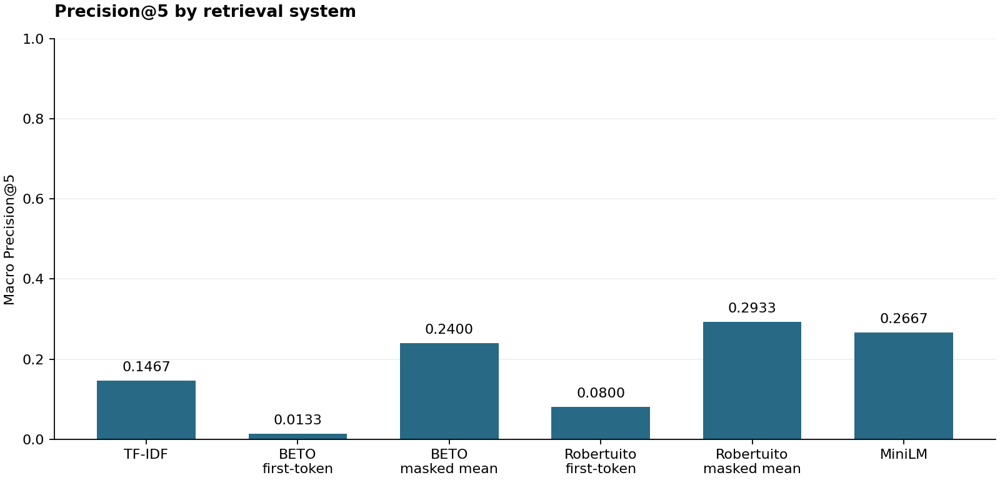
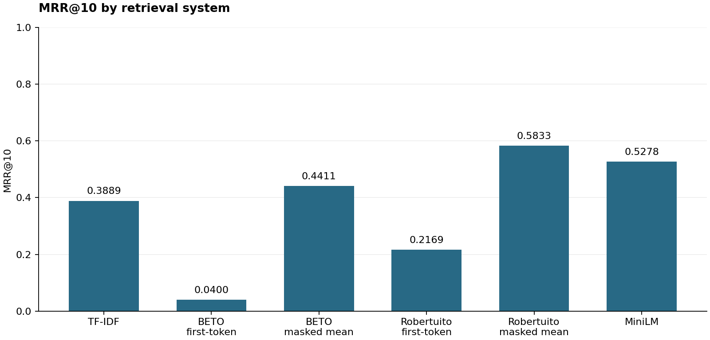
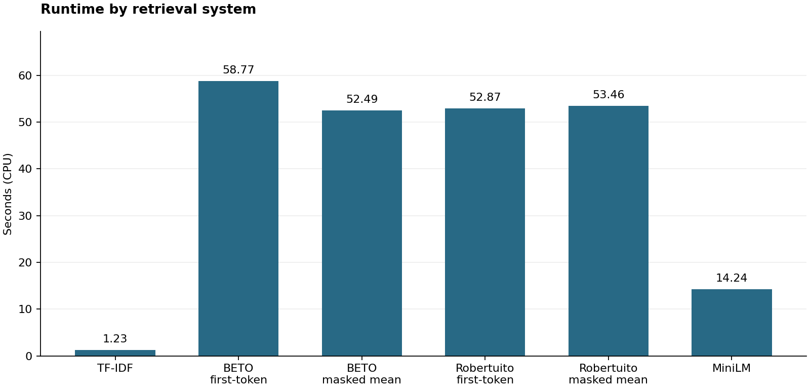

# Official Spanish headline retrieval benchmark

| System | Precision@5 | MRR@10 | Runtime (s) |
| --- | ---: | ---: | ---: |
| TF-IDF | 0.1467 | 0.3889 | 1.23 |
| BETO first-token | 0.0133 | 0.0400 | 58.77 |
| BETO masked mean | 0.2400 | 0.4411 | 52.49 |
| Robertuito first-token | 0.0800 | 0.2169 | 52.87 |
| Robertuito masked mean | 0.2933 | 0.5833 | 53.46 |
| MiniLM | 0.2667 | 0.5278 | 14.24 |

## Per-query results

Cells contain Precision@5 / Reciprocal Rank@10.

| Query | tfidf | beto_first_token | beto_masked_mean | robertuito_first_token | robertuito_masked_mean | minilm |
| --- | ---: | ---: | ---: | ---: | ---: | ---: |
| q01 | 0.2000 / 0.2500 | 0.0000 / 0.0000 | 0.4000 / 0.2500 | 0.0000 / 0.0000 | 0.2000 / 0.3333 | 0.0000 / 0.1667 |
| q02 | 0.6000 / 1.0000 | 0.0000 / 0.0000 | 0.6000 / 0.5000 | 0.0000 / 0.0000 | 0.6000 / 1.0000 | 0.8000 / 1.0000 |
| q03 | 0.2000 / 1.0000 | 0.0000 / 0.1000 | 0.2000 / 0.3333 | 0.0000 / 0.1429 | 0.6000 / 0.3333 | 0.4000 / 0.5000 |
| q04 | 0.0000 / 0.0000 | 0.0000 / 0.0000 | 0.4000 / 0.5000 | 0.0000 / 0.0000 | 0.2000 / 0.5000 | 0.2000 / 1.0000 |
| q05 | 0.0000 / 0.0000 | 0.0000 / 0.0000 | 0.0000 / 0.0000 | 0.0000 / 0.0000 | 0.0000 / 0.0000 | 0.4000 / 0.5000 |
| q06 | 0.2000 / 1.0000 | 0.0000 / 0.0000 | 0.2000 / 1.0000 | 0.0000 / 0.0000 | 0.2000 / 1.0000 | 0.2000 / 0.5000 |
| q07 | 0.2000 / 0.3333 | 0.0000 / 0.0000 | 0.0000 / 0.0000 | 0.0000 / 0.0000 | 0.0000 / 0.0000 | 0.0000 / 0.1667 |
| q08 | 0.0000 / 0.0000 | 0.2000 / 0.5000 | 0.2000 / 0.3333 | 0.0000 / 0.0000 | 0.2000 / 0.2500 | 0.2000 / 0.5000 |
| q09 | 0.0000 / 0.0000 | 0.0000 / 0.0000 | 0.6000 / 1.0000 | 0.0000 / 0.0000 | 0.4000 / 0.3333 | 0.0000 / 0.0000 |
| q10 | 0.4000 / 1.0000 | 0.0000 / 0.0000 | 0.2000 / 0.5000 | 0.2000 / 1.0000 | 0.4000 / 1.0000 | 0.4000 / 1.0000 |
| q11 | 0.2000 / 0.2500 | 0.0000 / 0.0000 | 0.4000 / 1.0000 | 0.4000 / 1.0000 | 0.4000 / 1.0000 | 0.2000 / 1.0000 |
| q12 | 0.0000 / 0.0000 | 0.0000 / 0.0000 | 0.2000 / 1.0000 | 0.0000 / 0.0000 | 0.2000 / 1.0000 | 0.2000 / 0.3333 |
| q13 | 0.2000 / 1.0000 | 0.0000 / 0.0000 | 0.0000 / 0.0000 | 0.0000 / 0.0000 | 0.0000 / 0.0000 | 0.4000 / 0.5000 |
| q14 | 0.0000 / 0.0000 | 0.0000 / 0.0000 | 0.2000 / 0.2000 | 0.0000 / 0.1111 | 0.2000 / 1.0000 | 0.2000 / 0.5000 |
| q15 | 0.0000 / 0.0000 | 0.0000 / 0.0000 | 0.0000 / 0.0000 | 0.6000 / 1.0000 | 0.8000 / 1.0000 | 0.4000 / 0.2500 |

## Methodology

The gold train/dev/test files contain 1,688 records. NFC/whitespace cleaning and
exact normalized-title deduplication produce 1,625 documents with stable
representative event IDs and complete source provenance. Classification splits
are combined as a retrieval corpus; their ESG labels are never relevance labels.

Six systems: TF-IDF; BETO first-token and masked mean; Robertuito first-token
and masked mean; `sentence-transformers/paraphrase-multilingual-MiniLM-L12-v2`.
First-token is the corrected historical baseline. Mean pooling includes
attended special tokens and excludes padding. MiniLM uses the documented
SentenceTransformer pipeline. Dense settings: CPU, batch size 32, 128-token
maximum, L2 normalization. See [encoder details](encoders.md).

The reviewer judged 648 unique query-document pairs while system identity,
scores and ranks were hidden. There are 43 positives; other in-pool documents
are binary 0 and outside-pool documents remain unjudged.

## Visualizations







## Interpretation

Robertuito masked mean has the highest aggregate metrics **on this test set**. MiniLM is close in quality and took 14.24 s versus 53.46 s in this CPU run. Masked mean substantially exceeds first-token pooling within both original encoders; TF-IDF remains a fast lexical baseline. Cross-model differences cannot be attributed solely to pooling: training data, architecture details and tokenization also differ. Raw cosine magnitudes are not compared, and no statistical significance or universal superiority is claimed.

On q05 only MiniLM found a positive within top 10. BETO masked mean scored 0.6 / 1.0 on q09. On q10 TF-IDF, Robertuito masked mean and MiniLM tied at 0.4 / 1.0 (Precision@5 / RR@10). No queries were removed.

## Limitations

The evaluation contains only 15 manually selected information needs and 43 positive judgments, covering 648 pooled query-document pairs. Queries were informed by corpus inspection, but selected before model outputs. Judgments use headline meaning, not ESG metadata. Documents outside each query pool remain unjudged. MRR is restricted to 10; full-corpus recall and unrestricted MRR are unsupported. Some queries have fewer than five positives, limiting their attainable Precision@5. Human ambiguity, title deduplication, truncation to 128 tokens, and the absence of tweet-specific Robertuito preprocessing constrain interpretation. Runtime includes model construction/loading, corpus encoding, query retrieval and scoring; cached CPU wall time is not a controlled latency benchmark.

## Reproducibility

Safe metadata and all configuration records are in [benchmark_results.json](../evaluation/benchmark_results.json). Raw scores and rankings remain local.

```json
{
  "corpus_identity": "479d26eba32546b09897fb7df6bc2db76030bd8cea64355a95af46f738e27300",
  "corpus_size": 1625,
  "query_count": 15,
  "positive_judgments": 43,
  "dataset": "DReggio/esg-spanish-events",
  "dataset_revision": "e900148694757d37df41035df090dd640052874d",
  "device": "cpu",
  "retrieval_top_k": 10,
  "versions": {
    "numpy": "2.3.0",
    "scikit-learn": "1.7.2",
    "torch": "2.14.1",
    "transformers": "4.57.6",
    "sentence-transformers": "5.7.0"
  },
  "python_version": "3.13.14 (tags/v3.13.14:fd17997, Jun 10 2026, 13:03:48) [MSC v.1944 64 bit (AMD64)]",
  "query_set_sha256": "d1ede27ff1263a175864c34c6fb441bb5ef1685591475cf545cfd29f6f5c54e9",
  "relevance_sha256": "a17b729694f586b69a0833b2a3c031a1a001253165a9f74635875efc7f90c94c",
  "judged_pairs": 648,
  "pool_fingerprints": {
    "q01": "acf25c4ed02d8f240fbb94f26619d771e7d9c60e71fdaecca8c65851ad5ce5bf",
    "q02": "47366351bfe97ee5c2d01f7ac965199b0e0d41ee008bf3cfa55e04ce4520f721",
    "q03": "a68ba650e309f575762ed9265cf6f7b94fae1b347fbbe44e5fb4fb3f2387790b",
    "q04": "1afb6f971ab910423e93794f0fb5929241564f2eff11d64277cc072574d22b9c",
    "q05": "8a3ef5cefc2dcaad92e96bde0e73f3228b715a675dc6ecd4e4f951915595ac90",
    "q06": "53cc6d8a9d5a1d00724553c06b8978ea6f1b96619bb7710fdb60c673146db990",
    "q07": "9fb080da1c1e57e7d3c9fbd06894e3b4b9b8178c31470920204ff61ca5e5cc4c",
    "q08": "7c98f124b3a4f943a3538d84986bb07b286b6a710d6917863977d2f45bd8533a",
    "q09": "f5e7698af4f0f331d3fbfa767b11da40171ce3fbffea5f265a876ce2c05d5306",
    "q10": "ff200a32b62529dec9690450e942e26a99e75ca527d4c18c15a2bb2a6a43e7cb",
    "q11": "2b2de272e186fa6a0ed67467a6ed88f619a742176e97c3a757dafe3b848a66d9",
    "q12": "ecad9e8616b2253ed761e5a4afab165d9e1f53de4f106ddea830df97b4707ce5",
    "q13": "c27bf57a5cb97ab96d9762426b7c114b104b071a79d4f8163632c3124e49f948",
    "q14": "fb9cda8d00ab8fb71b447fed5c02f8b52a360bdf22fc23fe67503778a4554e01",
    "q15": "3559dd5237bb3cad552f1babbe6222d40188cb43fac632ab3c7210d155412e7b"
  }
}
```

See the [README reproduction commands](../README.md#dataset-acquisition-and-reproduction). Dataset attribution: [DReggio/esg-spanish-events](https://huggingface.co/datasets/DReggio/esg-spanish-events), repository indicates CC BY-NC 4.0. Code and data are separate works.
